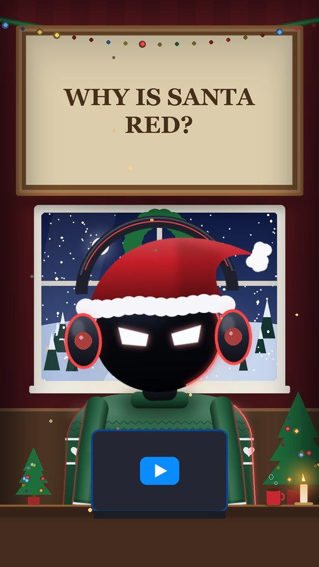
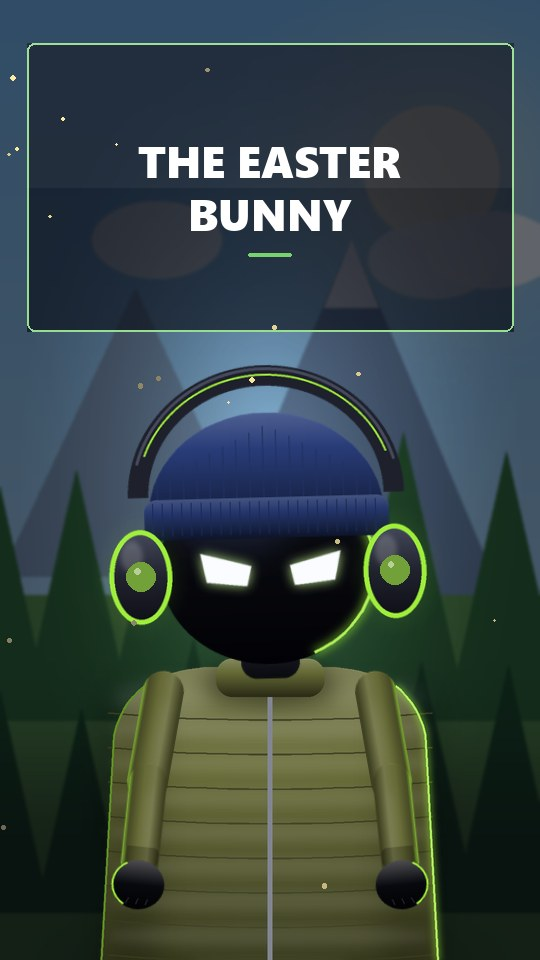
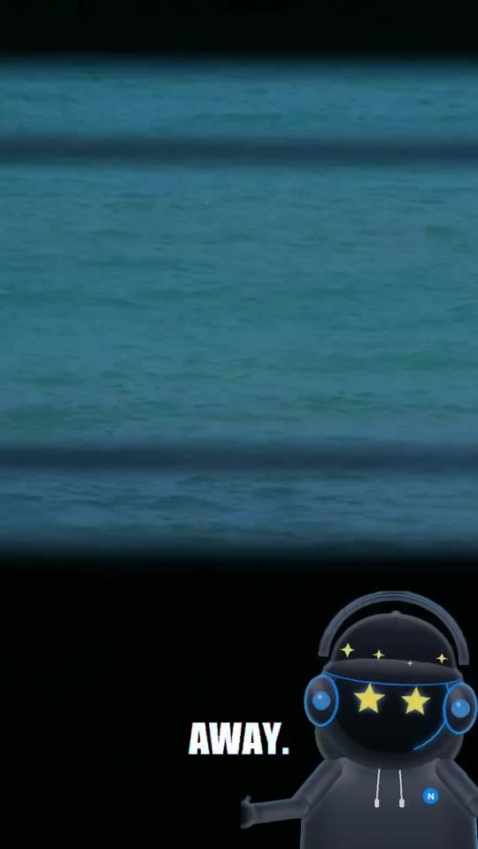
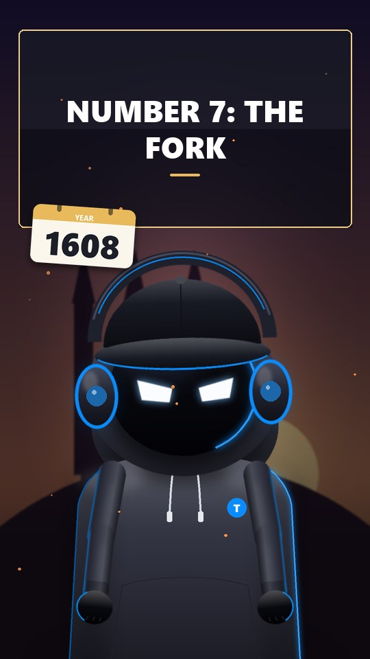

# Talking Character Studio

**Turn a script into a finished, faceless YouTube video, automatically.** Paste a script (or press *Random script*)
and the studio voices it with a natural AI voice, animates a character that talks, gestures and reacts, builds a
fresh scene for every chapter, adds word-synced captions and smart pop-up overlays, drops in free stock footage
and pictures, mixes your music, and renders an MP4 for Shorts or long-form.

Windows · Python · runs locally · free and open source (MIT)

Made by **[AtomicHD](https://www.youtube.com/@AtomicHD)**.

<p align="center">
     
</p>

## Features

| | |
|---|---|
| **Random script** | One click writes a complete 1 to 10 minute "hidden origins" countdown script, already tagged with chapters, scenes, gestures, faces, moves, footage and fact cards. |
| **Word-exact sync** | The AI voice reports when every word is spoken; captions, gestures, emphasis nods and overlays are timed to the exact word. |
| **Characters** | A shaded built-in presenter with 11 outfits, 16 hats, 16 colours and 10 glow colours, dressed for each scene or randomly. Or upload your **own character** (main, talking and blinking pictures); the background is removed automatically. |
| **Acting** | 18 gestures, 22 expressions (heart eyes, star eyes, tears, zzz, sunglasses…), nods, head shakes, jumps, leans and look-arounds, picked automatically from the words or set with tags. |
| **Scenes** | Generated **rooms** (studio, Christmas, Halloween, library, space deck, neon lab, cabin, ocean room, detective office) and **open-world** scenes with no desk (city, forest, snowy night, castle at dusk, space, under the sea) with weather, particles and depth of field. |
| **Smart overlays** | Years, numbers, places and highlighted words pop up as animated cards the moment they are said; `[note: …]` adds fact cards. |
| **Footage** | Free clips from Wikimedia Commons, NASA, Pexels and Pixabay (videos and animations), or your own clips. Shown on the set's screen, or full screen with the character standing **in the shot**, lit by the footage. |
| **Pictures** | Royalty-free pictures and Pixabay illustrations, licence-filtered (CC0, public domain, CC BY), with a credits file for your description. |
| **Camera & captions** | Wide, medium and close shots with push-ins; bold Shorts captions with the spoken word highlighted, or box / minimal styles. |
| **Music** | Background music that ducks under the voice and fades out. |
| **Formats** | 9:16 Shorts or 16:9 long-form, Full HD or fast draft, 24/30 fps, plus an `.srt` caption file. |

## Install (Windows)

1. Install **Python 3.10 or newer** from [python.org](https://www.python.org/downloads/) and tick *Add Python to PATH*.
2. Download this repository (green **Code** button → *Download ZIP*, or a zip from **Releases**) and unzip it.
3. Double-click **`Setup (run once).bat`**. It creates a private environment in `.venv` and installs three packages
   (Pillow, a bundled ffmpeg, and edge-tts).
4. Double-click **`Start Talking Character Studio.bat`**. The studio opens in your browser at http://127.0.0.1:8765/.
   Keep the black window open while you work.

No other software is needed: ffmpeg comes with the `imageio-ffmpeg` package.

## Make a video

1. **Script:** paste one, open a `.txt`/`.md` file, use a *Template*, or press **Random script** and pick a length.
2. **Character:** Classic, *Match each set*, *Surprise me*, *Custom* (outfit, hat, colours) or *My character*.
3. **Scenes:** every chapter gets its own scene. Choose *Mix*, *Rooms* or *Open world*, change any scene's theme or type, or press ⟳ for a new variation.
4. Pick a **voice**, caption style, pictures, footage and music, then **Preview 15 s** or **Generate video**.

Videos, captions, voiceovers and credits are saved in the `output` folder and listed in the **Library**.

## Script tags

Tags are optional; put them after the sentence they belong to.

| Tag | Does |
|---|---|
| `# Chapter title` | New chapter, new scene, title banner |
| `*word*` | Highlights a word (caption colour, sticker overlay, emphasis nod) |
| `[set: space]` | Scene theme: studio, christmas, halloween, history, space, tech, nature, ocean, mystery |
| `[point]` `[point up]` `[explain]` `[open]` `[think]` `[wave]` `[thumbs]` `[celebrate]` `[present]` `[shrug]` `[facepalm]` `[clap]` `[count]` `[stop]` `[fist]` `[type]` `[dance]` `[rest]` | Gestures |
| `[happy]` `[excited]` `[surprised]` `[shocked]` `[amazed]` `[love]` `[laugh]` `[wink]` `[cool]` `[confused]` `[suspicious]` `[think]` `[focused]` `[determined]` `[angry]` `[mad]` `[sad]` `[cry]` `[tired]` `[sleepy]` `[dizzy]` | Faces |
| `[nod]` `[shake]` `[bounce]` `[jump]` `[look around]` `[lean]` `[tilt]` | Moves |
| `[idea]` | Lightbulb |
| `[note: Not Coca-Cola!]` | Fact card overlay |
| `[image: roman forum]` · `[noimage]` | Picture to search for · no picture here |
| `[clip: rocket launch]` · `[broll: city at night]` | Footage on the set screen · full screen |
| `[clip: my interview @1:23]` | Your own clip, starting at 1:23 |

Without tags the studio picks gestures, faces and scenes from the words (for example "nobody knows" → shrug,
"amazing" → star eyes, "Santa" → Christmas scene).

**Writing with an AI chatbot:** *Templates → AI writing prompt → Copy* gives you a prompt that makes ChatGPT,
Claude or Gemini write scripts in exactly this format.

## Optional free API keys

Wikimedia Commons, NASA and the Cleveland Museum of Art work without an account. In **Settings** you can add free
keys for [Pexels](https://www.pexels.com/api/), [Pixabay](https://pixabay.com/api/docs/) (photos, illustrations,
vectors, videos and animations) and [Unsplash](https://unsplash.com/developers). Keys are stored only in
`config.json` on your computer (and are ignored by git).

## Command line

```
.venv\Scripts\python.exe make_video.py script.txt --out my_video --captions bold --footage inside --character theme
.venv\Scripts\python.exe scriptgen.py > random_script.txt
```

Run `make_video.py --help` for every option (voice, speed, landscape, draft, music, pictures, footage, characters…).

## How it works

| File | Role |
|---|---|
| `app.py` + `web/` | Local web server and interface |
| `pipeline.py` | Plans scenes, fetches media, runs the render |
| `speech.py` | AI / Windows voices, word timings and audio analysis |
| `scriptparse.py` · `scriptgen.py` | Reads scripts and tags · writes random scripts |
| `rig.py` · `motion.py` · `puppet.py` | Built-in character · poses and motion · uploaded characters |
| `sets.py` · `overlays.py` · `render.py` | Scenes · smart overlays · frame renderer and ffmpeg encoding |
| `images.py` · `footage.py` | Picture and footage search, licence filtering, safe downloads |

Rendering uses all CPU cores; Full HD renders at roughly 2 seconds per second of video on a typical PC (draft is
about 4 times faster).

## Notes and responsible use

* AI voices send the script text to Microsoft's online speech service. Picture and footage searches send your
  search words to the sources you enable. Everything else stays on your PC.
* Only media with licences that allow commercial use are fetched; a credits file is written when attribution is
  required. Check each source's licence for your use.
* The studio does not download from YouTube or other sites whose terms forbid it. Upload only clips you own or have
  the right to use.

## License

MIT, see [LICENSE](LICENSE).
